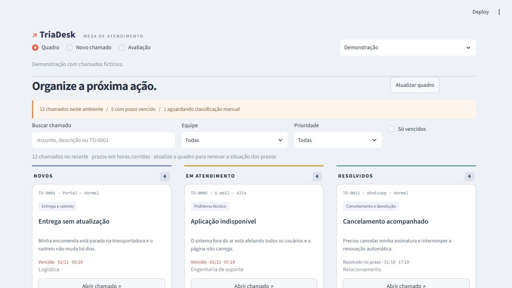
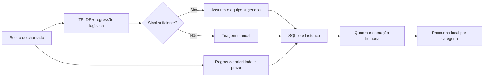

# ↗ TriaDesk

**Uma mesa de atendimento que transforma relatos em próximas ações.**

Organize chamados em **Novos → Em atendimento → Resolvidos**, receba sugestões de assunto e equipe, acompanhe os prazos e mantenha um histórico das decisões. A classificação usa aprendizado de máquina local; os rascunhos de resposta são textos por categoria, prontos para o operador adaptar.



## Experimente

No Windows, use Python 3.14 e execute os comandos abaixo na raiz do projeto. O navegador abre em `http://127.0.0.1:8504`.

Instalação em um ambiente separado:

```powershell
py -3.14 -m venv .venv
.\.venv\Scripts\python.exe -m pip install -r requirements.txt
.\.venv\Scripts\python.exe -m streamlit run app.py --server.port 8504 --server.showEmailPrompt false
```

O projeto é testado com Python 3.12 e executado localmente com Python 3.14. Em Linux/macOS, use `python3 -m venv .venv` e `.venv/bin/python` nos comandos.

## Fluxo de atendimento

1. **Abra a demonstração:** doze chamados fictícios mostram diferentes assuntos, estados e prazos.
2. **Filtre a operação:** busque por texto ou código, escolha equipe, prioridade ou apenas vencidos.
3. **Abra um cartão:** confira o relato, o prazo, o rascunho de resposta e a justificativa da sugestão.
4. **Conduza o atendimento:** confirme assunto e prioridade, registre uma nota interna e altere a situação.
5. **Consulte o histórico:** cada alteração mantém o estado anterior, o novo estado e a nota registrada.

O ambiente **Meus chamados** começa vazio e usa uma base separada da demonstração. Ambos mantêm as alterações após recarregar a página. Os canais E-mail, WhatsApp, Portal e Telefone são apenas informações da origem declarada; não conectam contas ou enviam mensagens.

## O que está implementado

| Recurso | Comportamento |
|---|---|
| Quadro operacional | Três colunas, cartões ordenados pelo prazo e filtros combináveis |
| Classificação de texto | TF-IDF de palavras/caracteres e regressão logística |
| Encaminhamento | Seis assuntos e respectivas equipes; sinal insuficiente segue para triagem manual |
| Prioridade | Regras explícitas com alteração pelo operador |
| Prazos | Alta: 4 h; normal: 24 h; baixa: 72 h, em horas corridas |
| Resposta sugerida | Modelos de texto locais por categoria, sem envio externo |
| Persistência | SQLite, transações e histórico de alterações |
| Concorrência | Versão por chamado; alterações desatualizadas são recusadas |
| Exportação | Recorte do quadro em CSV e chamado/histórico em JSON |
| API | Cadastro, consulta, alteração, classificação e documentação interativa |

### Assuntos e equipes

| Assunto | Equipe sugerida |
|---|---|
| Entrega e rastreio | Logística |
| Pagamentos | Financeiro |
| Conta e acesso | Suporte de acesso |
| Produto e qualidade | Pós-venda |
| Cancelamento e devolução | Relacionamento |
| Problema técnico | Engenharia de suporte |
| Triagem manual | Triagem |

O operador pode confirmar ou corrigir o assunto. A sugestão original permanece registrada. A equipe acompanha o assunto escolhido; não há atribuição a pessoas reais.

### Regras de prioridade e prazo

Expressões como **sistema fora do ar**, **sistema indisponível**, **todos os usuários**, **vazamento de dados**, **suspeita de invasão** e **conta invadida** sugerem prioridade alta. Sugestões, elogios e melhorias futuras sugerem baixa; o restante recebe normal. São heurísticas demonstrativas que podem exigir correção pelo operador.

O prazo começa na criação do chamado. Mudar a prioridade recalcula o prazo a partir da criação; reabrir um chamado mantém essa referência. A situação do prazo considera a resolução quando o chamado está encerrado. Não há calendário de expediente, finais de semana ou feriados. Use **Atualizar quadro** para renovar os indicadores de prazo.

As transições permitidas são Novo → Em atendimento; Em atendimento → Novo/Resolvido; Resolvido → Em atendimento. Um chamado precisa passar pelo atendimento antes de ser resolvido.

## Avaliação reproduzível

A base é **sintética, em português e criada para o projeto**. Há 96 exemplos de treino e 44 de verificação: seis exemplos para cada um dos seis assuntos e oito perguntas fora do escopo. O conjunto de verificação faz parte do desenvolvimento, portanto os resultados não representam validação independente com clientes reais.

```powershell
python -m triadesk evaluate
```

| Critério | Resultado no conjunto sintético |
|---|---:|
| F1 macro de encaminhamento, incluindo triagem | **0,804** |
| F1 macro da classe majoritária | 0,034 |
| Acerto de encaminhamento | 79,5% |
| Sugestões automáticas aceitas pelos limiares | 27 de 44 |
| Sugestões automáticas corretas neste conjunto | 27 de 27 |
| Casos encaminhados para triagem manual | 17 |
| Perguntas fora do escopo enviadas à triagem | 8 de 8 |

Dos 17 casos encaminhados para triagem, oito estavam fora do escopo e nove pertenciam a assuntos conhecidos. O acerto e o F1 de encaminhamento contam essas nove abstenções como erros, mesmo quando o assunto candidato estava correto. O acerto entre sugestões automáticas mede somente o subconjunto aceito; não equivale a 100% de acerto geral.

Os limiares são **0,40 de pontuação**, **0,08 de margem entre as duas primeiras classes** e **0,08 de similaridade com o treino**. As pontuações não são probabilidades calibradas. Há verificação de textos idênticos normalizados entre treino e teste; isso não elimina semelhança semântica entre os exemplos. A avaliação não mede a adequação dos rascunhos ou da prioridade sugerida em operações reais.

Consulte os [casos, a matriz de confusão e as métricas completas](reports/evaluation.json) ou a seção **Avaliação** no aplicativo.

## Testes

```powershell
python -m pip install -r requirements-dev.txt
python -m pytest -q
```

**37 testes** cobrem validação de entradas, ciclo de atendimento, reabertura, prazos, histórico, correção manual, persistência, conflitos de versão, classificação, rascunhos, demonstração, API e interface. O fluxo de testes do GitHub está em `.github/workflows/tests.yml`.

## API local

```powershell
python -m uvicorn triadesk.api:app --host 127.0.0.1 --port 8004
```

Abra `http://127.0.0.1:8004/docs` para testar as rotas.

| Rota | Finalidade |
|---|---|
| `GET /health` | Disponibilidade e versão |
| `POST /triage` | Sugestão de assunto, equipe e prioridade |
| `GET /tickets` | Lista de chamados e situação dos prazos |
| `POST /tickets` | Criação com triagem automática |
| `GET /tickets/{id}` | Chamado, histórico, rascunho e situação do prazo |
| `PATCH /tickets/{id}` | Alteração com versão atual do chamado |

Exemplo de criação:

```json
{
  "title": "Pagamento não confirmado",
  "description": "Paguei o boleto ontem e a compra continua aguardando pagamento.",
  "channel": "Portal"
}
```

Exemplo de alteração:

```json
{
  "version": 1,
  "status": "Em atendimento",
  "category": "pagamento",
  "priority": "Normal",
  "note": "Verificação do registro iniciada."
}
```

Uma versão desatualizada retorna HTTP 409; chamado inexistente retorna 404 e uma transição inválida retorna 422.

Também é possível classificar pela linha de comando:

```powershell
python -m triadesk triage "Meu pedido está atrasado e a transportadora não atualiza o rastreio."
```

## Dados e execução

Os arquivos `storage/demo.sqlite3` e `storage/chamados.sqlite3` são criados automaticamente e ignorados pelo Git. O primeiro recebe os exemplos na primeira execução; o segundo começa vazio. A API usa a base Meus chamados por padrão.

`TRIADESK_HOME` altera a pasta de armazenamento da interface e da API; `TRIADESK_DB` pode definir um arquivo específico somente para a API. Não é necessário configurar chave de API, instalar modelo remoto ou carregar arquivos pickle de terceiros.

O aplicativo é local, com persistência de conteúdo no computador. Não oferece autenticação ou controle de acesso por operador; a hospedagem externa exige esses recursos e limites de requisição. Os exemplos não contêm dados de clientes reais. O histórico é um registro operacional em SQLite, sem assinatura ou proteção contra alteração direta do arquivo.

## Arquitetura



Veja o [estudo de caso](docs/ESTUDO_DE_CASO.md) e a [descrição das amostras](data/README.md).
